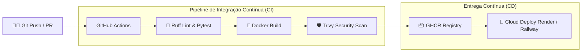

# 🚛 Diesel Fleet Monitor - API & DevOps Pipeline

[](https://github.com/Renan-Xavier/diesel-fleet-monitor/actions/workflows/ci-cd.yml)
[](https://www.docker.com/)
[](https://fastapi.tiangolo.com/)
[](https://www.python.org/)
[](LICENSE)

> **API REST para telemetria, auditoria e prevenção de fraudes e desvios no consumo de óleo diesel em frotas rodoviárias**, com esteira automatizada de **CI/CD no GitHub Actions**, containerização segura com **Docker (DevSecOps)** e pronto para deploy em nuvem.

---

## 🎯 O Problema de Negócio (A Dor do Diesel)

No setor logístico e de transporte rodoviário de cargas no Brasil, o **óleo diesel representa entre 40% e 50% de todo o custo operacional de uma transportadora**. Pequenas variações de consumo ou desvios causam prejuízos de milhares de reais todo mês.

### As principais dores enfrentadas pelos gestores de frota:
1. **Furtos e desvios de combustível:** Retirada de diesel do tanque durante a rota ou conluio em paradas não autorizadas.
2. **Fraude na nota fiscal / bomba:** Notas emitidas com volume de litros superior à capacidade física do tanque do caminhão.
3. **Falta de auditoria em tempo real:** A maioria das transportadoras só descobre prejuízos no final do mês ao fechar planilhas em Excel.

### 💡 A Solução:
Uma API leve e escalável que recebe os dados de cada abastecimento e realiza a auditoria imediata:
* Calcula a eficiência instantânea em **km/l** e o **custo por km rodado (R$)**.
* **Bloqueio de capacidade:** Identifica quando os litros cobrados excedem a capacidade do tanque.
* **Detecção de anomalias por tipo de veículo:** Emite alertas (`NORMAL`, `WARNING`, `CRITICAL`) caso o rendimento esteja fora dos parâmetros normais (ex: carreta pesada operando abaixo de 1.6 km/l).
* **Métricas para Observabilidade:** Endpoint `/metrics` para consumo de dashboards gerenciais.

---

## 🛠️ Arquitetura & Práticas DevOps

Como meu foco é **DevOps e Cloud**, este projeto foi desenhado seguindo as boas práticas da cultura ágil e de entrega contínua:



### Destaques de Engenharia e DevOps:
* **Containerização Otimizada & DevSecOps:**
  * Uso de imagem base `python:3.11-slim` para menor superfície de ataque e imagem mais leve (~150MB).
  * Criação de usuário de sistema sem privilégios de root (`appuser`) para execução do container.
  * `HEALTHCHECK` nativo configurado no Dockerfile consultando a rota `/health`.
  * Aproveitamento do cache de camadas do Docker (copiando `requirements.txt` antes do código-fonte).
* **Pipeline de CI/CD (GitHub Actions):**
  * **Etapa 1:** Análise estática com **Ruff** e execução de suíte de testes com **Pytest**.
  * **Etapa 2:** Build da imagem Docker e análise de vulnerabilidades em tempo de CI usando **Aqua Security Trivy**.
  * **Etapa 3:** Publicação automática no **GitHub Container Registry (GHCR)** com tags `latest` e hash do commit.
  * **Etapa 4:** Gatilho para deploy contínuo (CD).
* **Infraestrutura como Código (IaC):**
  * Arquivo `render.yaml` (Blueprint) para deploy com 1 clique.

---

## 🚀 Como Executar Localmente

### Opção 1: Usando Docker Compose (Recomendado)
Se tiver o Docker instalado, basta rodar:
```bash
docker compose up -d --build
```
A API estará acessível em: **`http://localhost:8000`** e a documentação interativa Swagger em **`http://localhost:8000/docs`**.

### Opção 2: Ambiente Python Local
```bash
# 1. Clone o repositório
git clone https://github.com/Renan-Xavier/diesel-fleet-monitor.git
cd diesel-fleet-monitor

# 2. Crie e ative um ambiente virtual
python -m venv .venv
# No Windows:
.venv\Scripts\activate
# No Linux/Mac:
source .venv/bin/activate

# 3. Instale as dependências
pip install -r requirements.txt

# 4. Execute a suíte de testes
pytest -v

# 5. Inicie a API
uvicorn app.main:app --reload --port 8000
```

---

## 📡 Endpoints da API

| Método | Rota | Descrição |
| :--- | :--- | :--- |
| `GET` | `/health` | **Health check** (Liveness & Readiness probe para orquestradores) |
| `GET` | `/metrics` | Métricas agregadas da frota (km/l médio, total gasto, anomalias) |
| `POST` | `/api/v1/fuel-logs` | Registra e audita um novo abastecimento de diesel |
| `GET` | `/api/v1/fuel-logs` | Lista abastecimentos (com filtros por placa ou status de anomalia) |
| `GET` | `/api/v1/fuel-logs/{id}` | Detalhes de um abastecimento específico |
| `GET` | `/docs` | Documentação interativa **Swagger OpenAPI** |

### Exemplo de Payload para Registro de Abastecimento:
```json
POST /api/v1/fuel-logs
Content-Type: application/json

{
  "vehicle_id": "CAR-1010",
  "driver_name": "Carlos Silva",
  "vehicle_type": "TRUCK_HEAVY",
  "tank_capacity_liters": 600.0,
  "odometer_km": 142500.0,
  "distance_traveled_km": 500.0,
  "liters_filled": 220.0,
  "fuel_cost_brl": 1320.0,
  "gas_station": "Posto Graal Rodovia SP-330"
}
```

### Exemplo de Resposta com Auditoria em Tempo Real:
```json
{
  "id": "a1b2c3d4",
  "created_at": "2026-11-01T23:50:00Z",
  "vehicle_id": "CAR-1010",
  "driver_name": "Carlos Silva",
  "vehicle_type": "TRUCK_HEAVY",
  "tank_capacity_liters": 600.0,
  "odometer_km": 142500.0,
  "distance_traveled_km": 500.0,
  "liters_filled": 220.0,
  "fuel_cost_brl": 1320.0,
  "gas_station": "Posto Graal Rodovia SP-330",
  "consumption_km_per_liter": 2.27,
  "cost_per_km_brl": 2.64,
  "anomaly_level": "NORMAL",
  "alert_message": "Consumo e abastecimento dentro dos limites operacionais normais."
}
```

---

## 🧪 Testes Automatizados

Os testes cobrem:
* Resposta e integridade do endpoint `/health`.
* Cálculos de km/l e custo por km.
* Disparo de alerta crítico em suspeitas de desvio/furto de combustível.
* Detecção de fraude por volume abastecido superior à capacidade do tanque.
* Agregação correta de métricas de frota.

Para rodar os testes:
```bash
pytest -v
```

---

## 💡 O que Aprendi Construindo este Projeto

1. **DevSecOps na prática:** Não basta criar um Dockerfile qualquer; é fundamental não rodar como `root`, manter imagens enxutas e incluir análise de vulnerabilidade (Trivy) diretamente na esteira de CI.
2. **Observabilidade desde o início:** Entendi a importância de endpoints como `/health` para garantir que o orquestrador não envie tráfego para instâncias não inicializadas.
3. **Automação de CI/CD:** Como transformar testes locais em uma esteira do GitHub Actions que barra códigos com falhas antes de gerar artefatos de produção.
4. **Resolução de problemas reais:** Conectar tecnologia com uma dor real de negócio (custo de diesel no transporte rodoviário) torna o projeto muito mais valioso do que um simples CRUD genérico.

---

## 👤 Autor

* **Renan Xavier** - [GitHub](https://github.com/Renan-Xavier)
